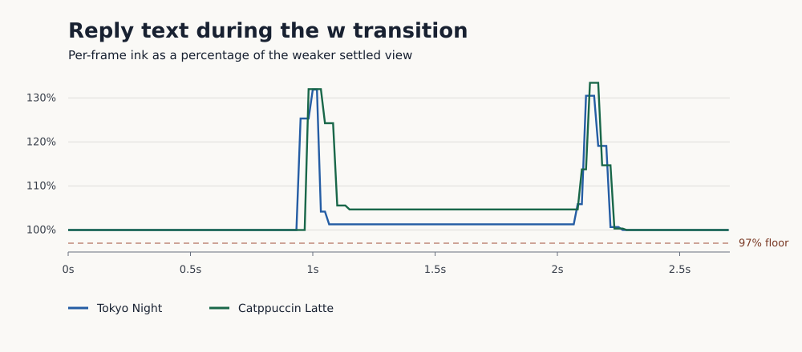

# PR 309 round 17

## Switching views with `w`

The built-in **Re: Pier lanterns** mail was opened in a nested 960 × 760 Sway session. Each
lossless capture contains simple → web → simple. The 60 Hz files include both settled
states and the wait for the first WebKit snapshot.

Ink is the sum of absolute RGB luma differences from the card fill over the same
224 × 120 px crop of the three open reply lines. The floor is 97% of the weaker
settled endpoint in each recording. The minimum was **100.0%** in both themes,
across 163 sampled frames each. The overlapping glyphs briefly increase the measured
ink during the fades.

| Theme | Simple | Web | Recording | Frame data |
| --- | --- | --- | --- | --- |
| Tokyo Night | [PNG](ink-dark-simple.png) | [PNG](ink-dark-web.png) | [MP4](ink-dark.mp4) | [CSV](ink-dark.csv) |
| Catppuccin Latte | [PNG](ink-light-simple.png) | [PNG](ink-light-web.png) | [MP4](ink-light.mp4) | [CSV](ink-light.csv) |

[Round 16 captures](../309-r16/README.md)

## Newsletter on open

The HTML-only Lakeside Dispatch demo mail was replayed with 2400, 1200, and 650 px
presentation table widths. The body card measures about 530 px at a 960 px window and
432 px at a 490 px window. The 650 px table has a 24 px outer gutter. Its 17 px body
text fits at approximately 13.4 px and 10.9 px, respectively.

| Table width | Default view | 960 px Tokyo Night | 960 px Latte | 490 px Tokyo Night | 490 px Latte |
| --- | --- | --- | --- | --- | --- |
| 2400 px | Simple | [PNG](2400-960-dark.png) | [PNG](2400-960-light.png) | [PNG](2400-490-dark.png) | [PNG](2400-490-light.png) |
| 1200 px | Simple | [PNG](1200-960-dark.png) | [PNG](1200-960-light.png) | [PNG](1200-490-dark.png) | [PNG](1200-490-light.png) |
| 650 px | Web | [PNG](650-960-dark.png) | [PNG](650-960-light.png) | [PNG](650-490-dark.png) | [PNG](650-490-light.png) |
